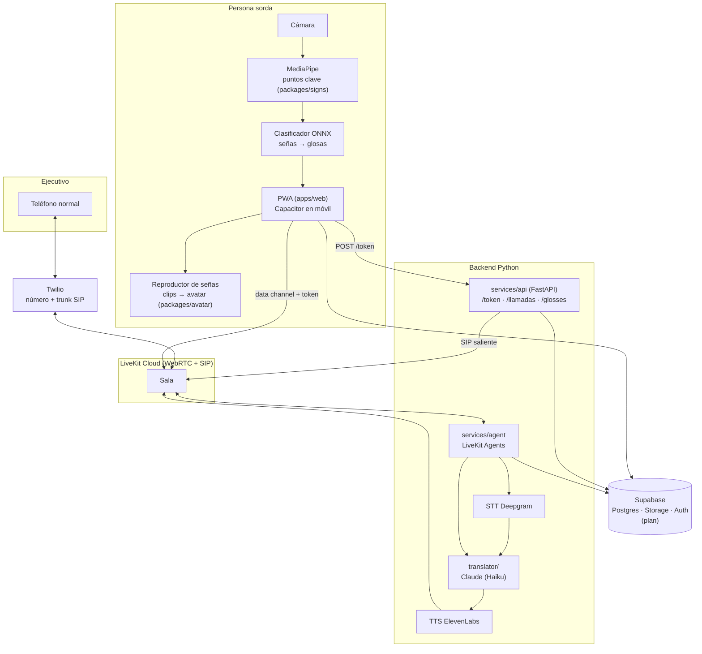
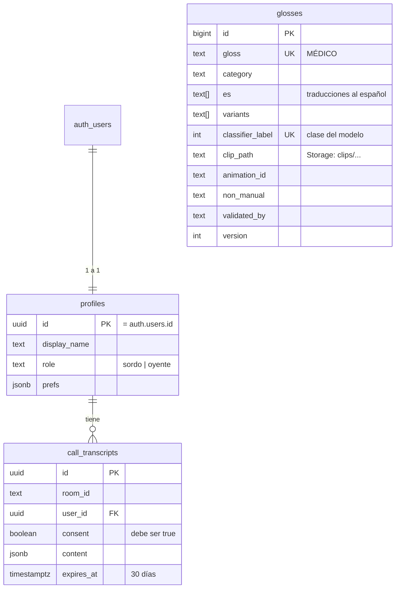
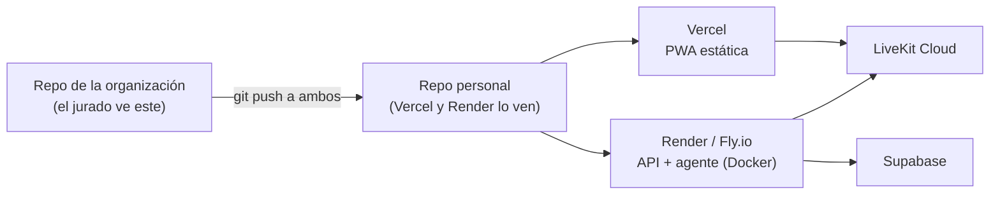

# Documentación técnica de Puente: arquitectura, base de datos e infraestructura

> Puente permite que una persona sorda haga llamadas telefónicas a servicios que solo atienden por teléfono
> (banco, hora médica, trámites). La voz del ejecutivo se convierte en texto simple (y, más adelante, en señas);
> lo que responde la persona sorda (texto o Lengua de Señas Chilena frente a la cámara) se convierte en voz.
>
> Las **decisiones y sus alternativas** están en [`docs/adr/`](adr/README.md). Este documento describe **cómo quedó**
> el sistema. Los mensajes entre piezas están en [`contrato.md`](contrato.md) y el reparto de trabajo en [`PLAN-TRABAJO.md`](PLAN-TRABAJO.md).

## 0. Estado: qué existe y qué es plan

| Pieza | Estado |
|---|---|
| Monorepo (pnpm + Turborepo + uv), CI, Dockerfiles | ✅ Existe; `typecheck`, `build` y `pytest` pasan |
| `packages/glosses` (diccionario + tipos del contrato) | ✅ Existe, con 12 glosas de ejemplo (`TODO(real-data)`) |
| `services/api`: `/health`, `/glosses`, `/token` | ✅ Existe y tiene tests |
| `services/api`: `/llamadas` (llamada SIP saliente) | 🟡 Stub: valida y responde 501 (`TODO(v1)`) |
| `services/agent`: traductor (Claude), validación de mensajes | ✅ Existe y tiene tests con cliente falso |
| `services/agent/agent.py` (LiveKit Agents, STT, TTS) | 🟡 Escrito contra la API de `livekit-agents 1.8.x`; **no se ha corrido contra servicios reales** |
| `apps/web` (PWA con subtítulos y cliente LiveKit) | 🟡 Esqueleto que compila |
| `packages/signs`, `packages/avatar`, `ml/training` | 🟡 Interfaces y README; sin modelo ni clips |
| Telefonía real (Twilio + LiveKit SIP) | ⬜ Plan (`services/agent/telefonia/README.md`) |
| **Base de datos (Supabase)** | ⬜ **Plan: no hay proyecto ni migraciones.** Hoy el diccionario es un JSON |
| Despliegue (Vercel, Render o Fly.io) | ⬜ Plan: nada está desplegado |
| `apps/desktop` (Tauri) | ⬜ Solo documentado |

---

## 1. Arquitectura

### 1.1 Vista general



### 1.2 Componentes por carpeta

| Carpeta | Qué es | Tecnología |
|---|---|---|
| `apps/web` | PWA del cliente: llamada, subtítulos, cámara. **Export estático** | Next.js 15, React 19, `livekit-client` |
| `apps/mobile` | Envuelve `apps/web/out` para Android e iOS | Capacitor 6 |
| `apps/desktop` | Opcional, solo documentado | Tauri |
| `packages/glosses` | **Fuente única de verdad**: diccionario de glosas, schema JSON y tipos del contrato | TypeScript + JSON Schema |
| `packages/signs` | Cámara → glosas: ventana de cuadros, clasificador, umbral de confianza | MediaPipe, onnxruntime-web (planificado) |
| `packages/avatar` | `SignPlayer` con `ClipSignPlayer` (clips por glosa); avatar 3D después | TypeScript; Three.js + VRM (planificado) |
| `packages/ui` | Subtítulos (`aria-live`) y avisos visuales accesibles | React |
| `services/api` | Tokens de LiveKit, llamadas salientes, diccionario | FastAPI, `livekit-api`, Twilio |
| `services/agent` | Participante traductor de la sala | `livekit-agents`, Deepgram, ElevenLabs, Anthropic |
| `ml/training` | Entrenamiento del clasificador de señas | PyTorch → ONNX (planificado) |
| `data/` | Investigación, vocabulario, evaluación (no se despliega) | — |

Regla: `apps/`, `packages/` y `services/` **no leen** de `data/research` ni de `docs/`.

### 1.3 Flujos principales

**v1: ejecutivo → cliente (voz a texto).** El ejecutivo habla por teléfono y entra a la sala como participante SIP.
El agente transcribe con Deepgram, el traductor simplifica con Claude y publica `ejecutivo_dice` por data channel.
La PWA lo muestra como subtítulo.

**v1/v2: cliente → ejecutivo (texto a voz).** La PWA envía `cliente_dice`. El agente valida el mensaje, el
traductor lo vuelve una frase natural y cortés (`complejizar`, pendiente en `agent.py`) y ElevenLabs la dice en la sala.

**v3: señas → voz.** La cámara produce puntos clave en el dispositivo; el clasificador emite glosas con confianza
(descarta lo que queda bajo 0,7). La PWA envía `glosas_cliente`; el traductor las convierte en una frase en español y se dice por TTS.

**v4: voz → señas.** El traductor convierte el español del ejecutivo en glosas (salida estructurada con una herramienta
`emitir_glosas`), valida cada una contra el diccionario, deletrea lo que no existe y publica `glosas_para_senar`
con un subtítulo. La PWA reproduce los clips en orden.

### 1.4 Contrato de mensajes (data channel de LiveKit)

Definido en `packages/glosses/src/contract.ts` (TS) y validado en `services/agent/guard.py` (Python).

| `tipo` | Emisor | Receptor | Campos |
|---|---|---|---|
| `ejecutivo_dice` | agente | PWA | `texto`, `simple?` (null o ausente si la v2 está apagada) |
| `cliente_dice` | PWA | agente | `texto` (≤ 500 caracteres) |
| `estado` | agente | PWA | `valor`: `llamada_iniciada` \| `llamada_terminada` |
| `glosas_cliente` | PWA | agente | `glosas[]` (≤ 30), `confianza` |
| `glosas_para_senar` | agente | PWA | `glosas[]`, `subtitulo` |

### 1.5 Glosas

Las glosas LSCh son el formato intermedio entre reconocimiento, LLM y reproductor, porque la LSCh es una lengua con
gramática propia y no español señado. Una glosa es válida si:
- existe en el diccionario (`packages/glosses/data/glosses.json`), **o**
- es deletreo con formato estricto `DACTILOLOGÍA:A-N-A` (máximo 20 letras).

No se reordenan los `classifierLabel` sin reentrenar el modelo.

### 1.6 Seguridad en el diseño

| Medida | Dónde |
|---|---|
| El servidor decide identidad, sala y rol del cliente; el token da permisos mínimos (sin publicar audio ni video) | `services/api` `/token` |
| El ejecutivo nunca recibe token: entra por SIP | ADR-0005 |
| El agente solo procesa mensajes de participantes con `role=cliente` asignado en el token | `services/agent/guard.py` |
| Validación de tipos, glosas conocidas y topes de tamaño antes de llegar al LLM o al TTS | `guard.py`, `contract.ts` |
| Llamadas salientes solo a una lista de números permitidos | `ALLOWED_DESTINATIONS` |
| El video no sale del dispositivo; no se graba audio ni video | ADR-0010 |

**Pendiente antes de desplegar:** exigir sesión en `/token`, límite de tasa por IP y usuario, tope de mensajes por sala
(costo de Claude y ElevenLabs) y firmar la sala para `/llamadas` (requerimiento A4 del plan).

---

## 2. Base de datos

### 2.1 Estado actual

**Todavía no hay base de datos.** El diccionario vive en `packages/glosses/data/glosses.json` (validado por
`gloss.schema.json`) y lo leen el agente (`translator/glossary.py`), la API (`GET /glosses`) y la PWA. Es suficiente
para la demo; el modelo de abajo es la **propuesta** de ADR-0009 para cuando se necesite persistir usuarios,
preferencias y archivos.

### 2.2 Modelo propuesto (Supabase / Postgres)



Correspondencia con el JSON actual: `classifierLabel` → `classifier_label`, `animationId` → `animation_id`,
`nonManual` → `non_manual`, `validatedBy` → `validated_by`, `clip` → `clip_path`.

### 2.3 SQL de referencia (aún no aplicado)

```sql
create table glosses (
  id               bigint generated always as identity primary key,
  gloss            text   not null unique check (gloss ~ '^[A-ZÁÉÍÓÚÑÜ0-9-]+$'),
  category         text   not null,
  es               text[] not null check (cardinality(es) > 0),
  variants         text[] not null default '{}',
  classifier_label int    not null unique check (classifier_label >= 0),
  clip_path        text,
  animation_id     text,
  non_manual       text,
  validated_by     text,
  version          int    not null default 1,
  updated_at       timestamptz not null default now()
);

create table profiles (
  id           uuid primary key references auth.users on delete cascade,
  display_name text,
  role         text not null check (role in ('sordo', 'oyente')),
  prefs        jsonb not null default '{}'
);

create table call_transcripts (
  id         uuid primary key default gen_random_uuid(),
  room_id    text not null,
  user_id    uuid not null references profiles(id) on delete cascade,
  consent    boolean not null check (consent),          -- solo se guarda con consentimiento explícito
  content    jsonb not null,
  created_at timestamptz not null default now(),
  expires_at timestamptz not null default now() + interval '30 days'
);

alter table glosses          enable row level security;
alter table profiles         enable row level security;
alter table call_transcripts enable row level security;

-- El diccionario es público de lectura; solo el backend (service role) escribe.
create policy glosses_read on glosses for select using (true);
-- Cada persona ve y edita solo lo suyo.
create policy profiles_own on profiles for all using (auth.uid() = id) with check (auth.uid() = id);
create policy transcripts_own on call_transcripts for all using (auth.uid() = user_id) with check (auth.uid() = user_id);
```

Retención: un job (`pg_cron`) borra las filas con `expires_at < now()`.

### 2.4 Storage (planificado)

| Bucket | Contenido | Acceso |
|---|---|---|
| `clips` | Un video por glosa, para `ClipSignPlayer` | Lectura pública (CDN) |
| `animations` | Animaciones del avatar 3D | Lectura pública |
| `models` | Clasificador `.onnx` versionado | Lectura pública; escritura solo con service role |

El dataset de entrenamiento (puntos clave grabados con consentimiento) **no** va a Supabase: queda en `ml/data/`, ignorado por git.

### 2.5 Reglas de uso

- `SUPABASE_SERVICE_ROLE_KEY` solo en el backend; nunca en el cliente ni con prefijo `NEXT_PUBLIC_`.
- Al cargar el diccionario a la base de datos, `glosses.json` sigue siendo la fuente y se exporta al build de la PWA
  para que funcione sin conexión.
- Fuera del MVP: guardar transcripciones. Si se activa, solo con `consent = true`.

---

## 3. Infraestructura

### 3.1 Proveedores

| Servicio | Para qué | Plan inicial | Estado |
|---|---|---|---|
| **LiveKit Cloud** | Salas WebRTC, SIP y hosting del agente | Gratuito | ⬜ Proyecto por crear |
| **Twilio** | Número y trunk SIP hacia LiveKit | Cuenta trial: solo llama a números verificados | ⬜ Por configurar |
| **Anthropic** | Traductor (`claude-haiku-5-5`) | De pago por uso | Clave en `.env` |
| **Deepgram** | STT en streaming (español) | Créditos de prueba | Candidato; falta benchmark con audio chileno |
| **ElevenLabs** | TTS con voz chilena | Cuota limitada | Falta elegir `ELEVENLABS_VOICE_ID` |
| **Supabase** | Postgres, Storage, Auth | Gratuito (pausa por inactividad) | ⬜ Plan |
| **Vercel** | Hosting de la PWA | Gratuito | ⬜ Desde un repo personal (ver abajo) |
| **Render o Fly.io** | Contenedores de API y agente | Gratuito o barato | ⬜ Fly.io tiene región Santiago (`scl`) |

### 3.2 Ambientes

| Ambiente | Qué corre | Cómo |
|---|---|---|
| Local | Todo, con LiveKit Cloud real o mocks | Ver 3.5 |
| Demo / producción | PWA en Vercel; API y agente en contenedores | Ver 3.3 |

No hay un ambiente de staging.

### 3.3 Despliegue (plan, ADR-0011)



- Vercel y Render **no pueden conectarse al repo de la organización**: se despliega desde un repo personal con doble `push`
  (ver `docs/ONBOARDING.md` §4). Solo una persona despliega: **Raimundo**, desde su repo personal.
- La PWA necesita **HTTPS** (la cámara no funciona sin él).
- El agente es un proceso de larga duración: **no cabe en funciones serverless**.
- Los secretos van como variables del proveedor; nunca en el repo.
- **Paso a paso con comandos:** [`DESPLIEGUE.md`](DESPLIEGUE.md).

### 3.4 Contenedores

Ambos Dockerfiles se construyen **desde la raíz del repo** (necesitan `packages/glosses`):

```bash
docker build -f services/api/Dockerfile   -t puente-api .
docker build -f services/agent/Dockerfile -t puente-agent .
```

Multi-stage con `uv sync --frozen`, imagen `python:3.12-slim` y usuario no root (uid 10001). La API expone el puerto 8000.
El agente se inicia con `python agent.py start`. **No se han construido todavía** (no había Docker en el equipo de desarrollo).

### 3.5 Desarrollo local

```bash
pnpm install                                                      # dependencias JS
uv --directory services/api   sync                                # dependencias Python
uv --directory services/agent sync
cp .env.example .env                                              # y rellenar las claves

pnpm --filter @puente/web dev                                     # PWA en :3000
uv --directory services/api   run uvicorn app.main:app --reload   # API en :8000
uv --directory services/agent run python agent.py dev             # agente (requiere LiveKit)
```

Verificación: `pnpm typecheck && pnpm build` y `uv --directory services/<api|agent> run pytest`.

### 3.6 CI (`.github/workflows/ci.yml`)

En cada PR y en cada push a `main`:

| Job | Hace |
|---|---|
| `web` | `pnpm install --frozen-lockfile`, `pnpm typecheck`, `pnpm build` |
| `python` (api y agent) | `uv sync --frozen`, `uv run pytest -q` |
| `dockerfiles` | `hadolint` sobre ambos Dockerfiles |

No hay CD: el despliegue lo dispara el `push` al repo personal.

### 3.7 Variables de entorno

Todas están en `.env.example`. Los secretos solo en `.env` (nunca commitear).

| Variable | Usa | Notas |
|---|---|---|
| `ANTHROPIC_API_KEY` | agent | Secreto |
| `TRANSLATOR_MODEL` | agent | Por defecto `claude-haiku-5-5` |
| `ESCENARIO_DEMO` | agent | Contexto del prompt (banco, hora médica) |
| `DEEPGRAM_API_KEY`, `STT_LANGUAGE` | agent | STT; `es` por defecto |
| `ELEVENLABS_API_KEY`, `ELEVENLABS_VOICE_ID`, `ELEVENLABS_MODEL` | agent | TTS; modelo por defecto `eleven_flash_v2_5` |
| `LIVEKIT_URL`, `LIVEKIT_API_KEY`, `LIVEKIT_API_SECRET` | api, agent | Secretos (salvo la URL) |
| `LIVEKIT_SIP_TRUNK_ID` | api | Trunk SIP saliente hacia Twilio |
| `TWILIO_ACCOUNT_SID`, `TWILIO_AUTH_TOKEN`, `TWILIO_PHONE_NUMBER` | api | Secretos |
| `ALLOWED_DESTINATIONS` | api | Números E.164 permitidos, separados por coma |
| `CORS_ORIGINS` | api | Por defecto `http://localhost:3000`; en producción, la URL de la PWA, **nunca `*`** |
| `PUBLIC_BASE_URL` | — | Heredada del scaffold original (URL pública del backend para webhooks de Twilio); hoy ningún código la lee |
| `GLOSSES_PATH` | api, agent | Opcional: otra ruta al `glosses.json` |
| `SUPABASE_URL`, `SUPABASE_ANON_KEY` | web, api | Públicas |
| `SUPABASE_SERVICE_ROLE_KEY` | api | **Solo backend** |
| `NEXT_PUBLIC_API_URL` | web | Se expone al navegador |

### 3.8 Límites conocidos

- **Latencia:** objetivo menor a 3 s por turno (STT + LLM + TTS); aún sin medir con servicios reales.
- **Concurrencia:** un proceso de agente por llamada; sin pruebas de carga (meta del MVP: ~10 llamadas).
- **Telefonía:** el audio llega a 8 kHz y el STT con acento chileno por teléfono no está medido.
- **Observabilidad:** no hay métricas, trazas ni alertas; solo los logs del proceso.
- **Costos:** Claude y ElevenLabs cobran por uso; sin rate limit, `/token` es un vector de gasto (ver 1.6).
- **Cuentas gratuitas:** Supabase pausa proyectos inactivos y los contenedores gratuitos "duermen"; mantenerlos
  despiertos antes de la demo.

### 3.9 Checklist antes de la demo

1. Credenciales de LiveKit, Twilio, ElevenLabs, Deepgram y Anthropic cargadas en los proveedores.
2. `ALLOWED_DESTINATIONS` con los números de la prueba y `CORS_ORIGINS` con la URL real de la PWA.
3. `/token` con sesión o clave de demo y límite de tasa (requerimiento A4).
4. Voz chilena elegida (`ELEVENLABS_VOICE_ID`) y probada con frases del escenario.
5. Contenedores y proyecto de Supabase **despiertos** (hacer una llamada de prueba minutos antes).
6. PWA instalada en el celular de la demo, con HTTPS.
7. Plan de reserva: teclado de glosas si el reconocimiento por cámara no llega a tiempo.
