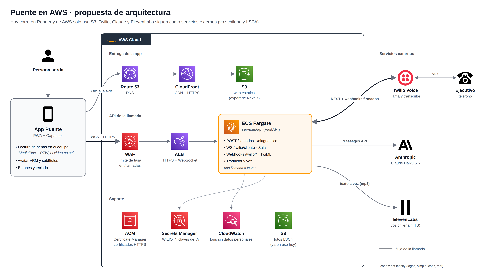
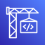

# Iconos de AWS para diseñar la arquitectura

> ⚠️ **Puente no corre en AWS.** Hoy el plan usa Vercel, Fly.io, LiveKit Cloud, Supabase y proveedores de IA
> ([`ARQUITECTURA.md`](ARQUITECTURA.md)). Este archivo sirve para **dibujar** la arquitectura con iconos de AWS
> (por ejemplo, para el pitch o para una versión "si lo montáramos en AWS"), no cambia nada del despliegue.

## Qué hay en esta carpeta

`docs/diagramas/iconos-aws/` tiene **63 logos en SVG** (galería al final). Sirven para arrastrarlos a draw.io, Excalidraw,
Figma, Canva o PowerPoint. Todos tienen alto 64 px y mantienen su proporción.

**Límites que debes conocer:**
- Vienen del set comunitario [Iconify `logos`](https://icon-sets.iconify.design/logos/), **no** del paquete oficial *AWS Architecture Icons*.
  Se ven parecidos, pero no son idénticos a los de los diagramas oficiales de AWS.
- **Faltan justo los servicios que equivaldrían a tu arquitectura:** Amazon Transcribe, Polly, Bedrock, Connect, Chime SDK y ECR.
  Tampoco hay los contenedores de grupo (Región, VPC, subred, nube de AWS).
- Son marcas de sus dueños. Si los vas a publicar, revisa las [pautas de uso de AWS](https://aws.amazon.com/architecture/icons/).

### Para un resultado profesional: el paquete oficial
1. Entra a <https://aws.amazon.com/architecture/icons/> y descarga el **Asset Package** (un `.zip`).
2. Trae iconos de servicios, de recursos, de categorías y los **grupos** (Región, VPC, etc.) en SVG y PNG.
3. En **draw.io** también hay librerías de AWS integradas: *Más formas* (+) → marca *AWS*.

No incluí el paquete oficial en el repo: pesa varios MB y conviene bajarlo siempre en su versión vigente.

## Cómo se vería Puente en AWS

Equivalencias aproximadas (no están probadas; verifica disponibilidad y precios antes de decidir):

| Pieza de Puente | Hoy | Equivalente en AWS | Icono en esta carpeta |
|---|---|---|---|
| PWA estática | Vercel | S3 + CloudFront (o Amplify Hosting) | `s3`, `cloudfront`, `amplify` |
| DNS y HTTPS | Vercel / Fly | Route 53 + Certificate Manager | `route53`, `certificate-manager` |
| API (FastAPI) | Fly.io | ECS sobre Fargate detrás de un ELB, o API Gateway + Lambda | `ecs`, `fargate`, `elb`, `api-gateway`, `lambda` |
| Agente traductor (proceso largo, sin puerto) | Fly.io | ECS sobre Fargate (servicio sin balanceador) | `ecs`, `fargate` |
| Salas WebRTC | LiveKit Cloud | Sin gestionado equivalente 1 a 1: LiveKit autohospedado en EC2/EKS, o Amazon Chime SDK | `ec2`, `eks` (Chime: falta) |
| Telefonía (SIP/PSTN) | Twilio | Amazon Connect o Chime SDK Voice Connector | **falta** |
| Voz a texto | Deepgram | Amazon Transcribe (verifica el soporte de español de Chile) | **falta** |
| Texto a voz | ElevenLabs | Amazon Polly (verifica si hay voz chilena) | **falta** |
| LLM del traductor | API de Anthropic | Amazon Bedrock (verifica disponibilidad del modelo) | **falta** |
| Base de datos | Supabase Postgres | RDS para PostgreSQL o Aurora | `rds`, `aurora` |
| Archivos (clips, modelos ONNX) | Supabase Storage | S3 | `s3` |
| Autenticación | Supabase Auth | Cognito | `cognito` |
| Secretos | Variables de Fly | Secrets Manager / Systems Manager | `secrets-manager`, `systems-manager` |
| Logs y métricas | Logs del proceso | CloudWatch (+ X-Ray para trazas) | `cloudwatch`, `xray` |
| CI/CD | GitHub Actions + push | CodePipeline y CodeBuild (o seguir con Actions) | `codepipeline`, `codebuild` |
| Protección de `/token` | — | WAF (límite de tasa) y Shield | `waf`, `shield` |
| Desacoplar eventos | — | SQS, SNS o EventBridge | `sqs`, `sns`, `eventbridge` |

> El **WAF con límite de tasa** resolvería parte del requerimiento A4 del plan (`/token` sin límite es un riesgo de costo).

## Diagrama ya hecho: Puente en AWS

[`04-puente-en-aws.png`](diagramas/arquitectura/04-puente-en-aws.png) (3840×2160, para slides) y su fuente
[`04-puente-en-aws.svg`](diagramas/arquitectura/04-puente-en-aws.svg) (íconos incrustados: se abre en draw.io, Figma o el navegador).
Es una **propuesta**: la API pasa a ECS Fargate detrás de WAF y ALB, la PWA a S3 + CloudFront, y Twilio, Claude y ElevenLabs
quedan como servicios externos. Los logos de Twilio, Anthropic y ElevenLabs vienen de Iconify (`logos`, `simple-icons`).

## Consejos para el diagrama
- Una sola dirección de lectura: **izquierda → derecha** (cliente → teléfono/IA → datos).
- Distingue con color o línea punteada lo **implementado** de lo **plan**, como en [`UML.md`](UML.md).
- Etiqueta cada flecha con el protocolo o el mensaje (`HTTPS`, `WebRTC`, `SIP`, `ejecutivo_dice`).
- Los diagramas ya hechos en Mermaid están en [`UML.md`](UML.md) y [`ARQUITECTURA.md`](ARQUITECTURA.md): sirven de borrador.

## Galería (63 iconos)

| Icono | Archivo |
|---|---|
|  | `amplify.svg` |
|  | `api-gateway.svg` |
|  | `app-mesh.svg` |
|  | `appflow.svg` |
|  | `appsync.svg` |
|  | `athena.svg` |
|  | `aurora.svg` |
|  | `aws.svg` |
|  | `backup.svg` |
|  | `batch.svg` |
|  | `certificate-manager.svg` |
|  | `cloudformation.svg` |
|  | `cloudfront.svg` |
|  | `cloudsearch.svg` |
|  | `cloudtrail.svg` |
|  | `cloudwatch.svg` |
|  | `codebuild.svg` |
|  | `codecommit.svg` |
|  | `codedeploy.svg` |
|  | `codepipeline.svg` |
|  | `codestar.svg` |
|  | `cognito.svg` |
|  | `config.svg` |
|  | `documentdb.svg` |
|  | `dynamodb.svg` |
|  | `ec2.svg` |
|  | `ecs.svg` |
|  | `eks.svg` |
|  | `elastic-beanstalk.svg` |
|  | `elasticache.svg` |
|  | `elb.svg` |
|  | `eventbridge.svg` |
|  | `fargate.svg` |
|  | `glacier.svg` |
|  | `glue.svg` |
|  | `iam.svg` |
|  | `keyspaces.svg` |
|  | `kinesis.svg` |
|  | `kms.svg` |
|  | `lake-formation.svg` |
|  | `lambda.svg` |
|  | `lightsail.svg` |
|  | `mq.svg` |
|  | `msk.svg` |
|  | `neptune.svg` |
|  | `open-search.svg` |
|  | `opsworks.svg` |
|  | `quicksight.svg` |
|  | `rds.svg` |
|  | `redshift.svg` |
|  | `route53.svg` |
|  | `s3.svg` |
|  | `secrets-manager.svg` |
|  | `ses.svg` |
|  | `shield.svg` |
|  | `sns.svg` |
|  | `sqs.svg` |
|  | `step-functions.svg` |
|  | `systems-manager.svg` |
|  | `timestream.svg` |
|  | `vpc.svg` |
|  | `waf.svg` |
|  | `xray.svg` |
