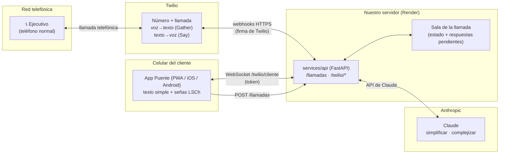
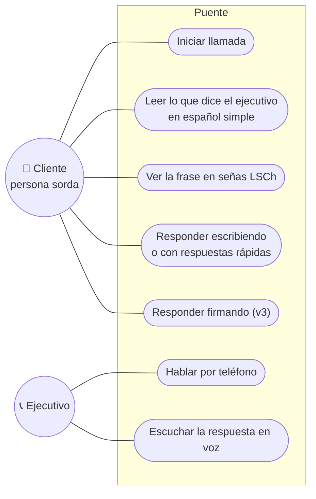
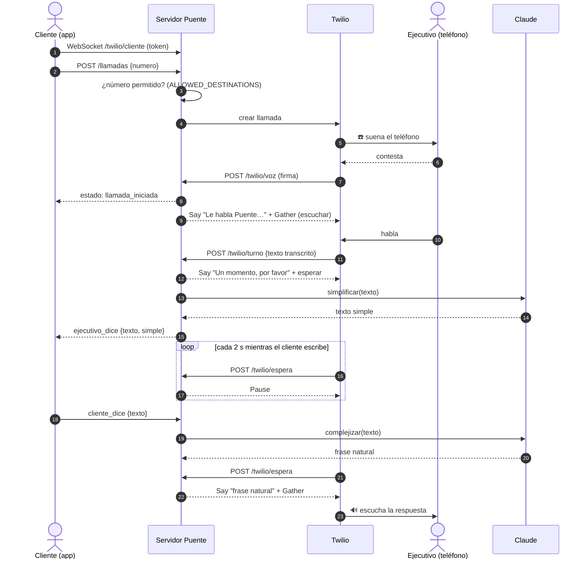
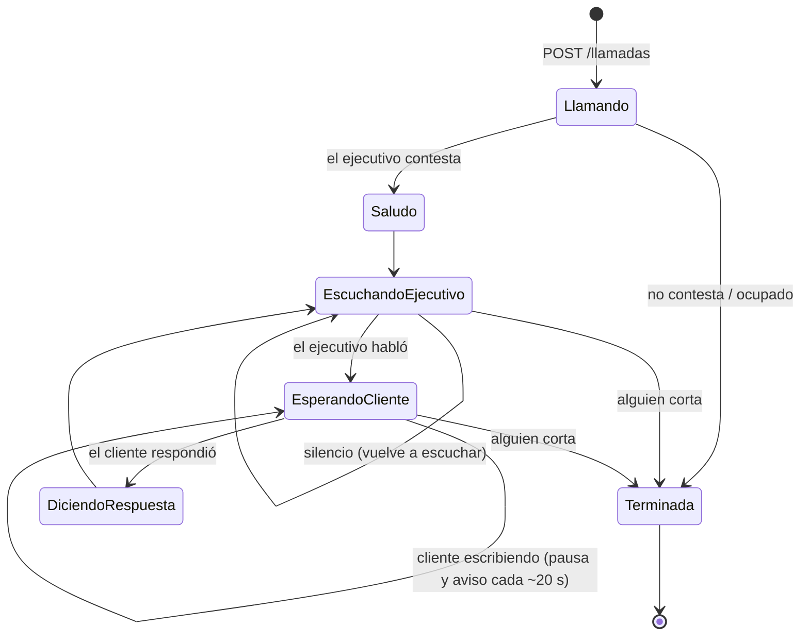

# Puente: guía para la presentación

Material para armar las diapositivas y el discurso. El orden es problema → solución → demo → cómo funciona → qué sigue.
Los diagramas se ven dibujados en GitHub (Mermaid). Al final hay una propuesta de diapositivas con notas para quien presenta.

> Datos marcados con ⚠️ hay que verificarlos antes de mostrarlos. No inventamos cifras.

---

## 1. En una frase

**Puente permite que una persona sorda haga y reciba llamadas telefónicas, sin que la persona del otro lado instale nada.**
Lo que dice la otra persona se vuelve texto simple (y señas); lo que responde la persona sorda se vuelve voz.

---

## 2. El problema

- Muchos trámites **solo se resuelven por teléfono**: pedir una hora médica, hablar con el banco, servicios del Estado y, el caso más grave, **pedir una ambulancia**.
- Una persona sorda **no puede hacer esas llamadas sola**. Depende de un familiar, un amigo o un intérprete, y pierde autonomía y privacidad (tiene que contarle su diagnóstico o su deuda a un tercero).
- Para muchas personas sordas **el español escrito es su segunda lengua**. Su primera lengua es la **Lengua de Señas Chilena (LSCh)**, que tiene gramática propia. Por eso un subtítulo literal ("Estimado paciente, le informamos que su hora ha sido reagendada…") no siempre se entiende bien.
- Las alternativas actuales no resuelven el problema completo: el chat o el correo no existen en todos los servicios; las videollamadas con intérprete requieren que **el otro lado** se adapte; los subtítulos automáticos no permiten **responder**.
- ⚠️ Completar con una cifra verificada de personas sordas o con discapacidad auditiva en Chile (por ejemplo, ENDISC o SENADIS), citando la fuente.

**Frase para el pitch:** "Hoy, si una persona sorda necesita una ambulancia para su hijo, tiene que encontrar a alguien que llame por ella."

---

## 3. Nuestra solución

| | Persona sorda (el **cliente**) | Persona al teléfono (el **ejecutivo**) |
|---|---|---|
| Qué usa | La app Puente en su celular | **Su teléfono de siempre**. No instala nada |
| Qué recibe | Lo que dice el ejecutivo, **en español simple** y en **señas** | La respuesta del cliente **en voz**, con una frase natural |
| Cómo responde | Escribiendo, con respuestas rápidas (Sí / No / No entendí) o, en la versión avanzada, **firmando** frente a la cámara | Hablando normal |

Tres ideas clave:
1. **Cero fricción para el otro lado.** La clínica o el banco no cambian nada: reciben una llamada telefónica normal.
2. **No es solo transcribir, es interpretar.** Un modelo de lenguaje (Claude) **simplifica** lo que dice el ejecutivo y **convierte** lo que escribe el cliente en una frase natural y cortés.
3. **Respeta la lengua de la comunidad sorda.** El texto simple va acompañado de **señas LSCh**, y la meta es que el cliente pueda responder firmando.

---

## 4. La demo

Escenario elegido por el equipo: **una persona sorda llama a urgencias de la clínica para pedir una ambulancia** (su hijo se cayó y se quebró el codo).

Lo que se ve en vivo:
1. El cliente aprieta **"Pedir una ambulancia"** en la app.
2. **Suena un teléfono real** (el de un integrante del equipo, que hace de clínica).
3. Al contestar, el teléfono dice: *"Hola. Le habla Puente, un servicio de interpretación para una persona sorda…"*.
4. La "clínica" habla por teléfono → en la app aparece **en español simple** y con **señas**.
5. El cliente responde con un botón o escribiendo → la clínica **lo escucha en voz** como una frase natural.

Ejemplo real, probado con una llamada a un celular:

| Lo que pasa | Texto |
|---|---|
| El ejecutivo dice | "Para agendar necesito su RUT y si es Fonasa o Isapre." |
| El cliente lee (simplificado por Claude) | "Para reservar su hora, necesito dos datos. Su RUT. Su previsión de salud. ¿Es Fonasa o Isapre?" |
| El cliente escribe | `yo fonasa rut 12.345.678-9` |
| El ejecutivo escucha | "Tengo Fonasa, mi RUT es 12.345.678-9." |

---

## 5. Cómo funciona (versión simple, para el público)

1. **Twilio** es nuestra línea telefónica: tiene un número real, llama a la clínica, convierte su voz en texto y convierte nuestro texto en voz.
2. **Nuestro servidor** (Python + FastAPI, en Render) recibe el texto y coordina todo.
3. **Claude** (Anthropic) hace de intérprete: simplifica para el cliente y redacta la respuesta para el ejecutivo.
4. **La app** (Next.js, instalable en el celular) muestra el texto y las señas, y manda las respuestas del cliente.

La conversación va **por turnos**: el ejecutivo habla, el cliente responde y el ejecutivo escucha. Mientras el cliente escribe, el ejecutivo escucha "Un momento, por favor".

---

## 6. Arquitectura (componentes)

Piezas del repositorio:

| Pieza | Carpeta | Qué hace |
|---|---|---|
| App | `apps/web`, `apps/mobile` | Pantallas, señas y respuestas rápidas. Se instala como PWA, Android (APK) o iOS (Xcode) |
| Señas | `packages/avatar`, `packages/signs`, `packages/glosses` | Reproductor de señas, reconocimiento por cámara (en progreso) y diccionario de glosas LSCh |
| Servidor | `services/api` | Llamadas, conversación por turnos con Twilio y canal con la app |
| Traductor | `lab/v2_simplificar/prompts.py`, `services/agent/translator` | Prompts de Claude para simplificar y complejizar |

---

## 7. Diagramas UML

### 7.1 Casos de uso

### 7.2 Secuencia: una llamada completa (lo que funciona hoy)

### 7.3 Estados de la llamada

Más diagramas (clases, despliegue y secuencias de señas) en `docs/UML.md`.

---

## 8. Decisiones técnicas (la historia de ingeniería)

Sirve para el criterio **aspecto técnico**: mostrar que probamos, medimos y cambiamos de plan con datos.

1. **Plan original:** LiveKit (sala de audio en tiempo real) conectada al teléfono por SIP con Twilio, para una conversación fluida.
2. **Lo probamos con llamadas reales** en la cuenta gratuita de Twilio y documentamos qué funciona:

| Opción | Resultado en la cuenta de prueba |
|---|---|
| SIP hacia LiveKit (trunk o `<Dial><Sip>`) | ❌ bloqueado |
| Audio en vivo (Media Streams) | ❌ bloqueado |
| Voz de Twilio (`<Say>`) | ✅ |
| Reconocimiento de voz de Twilio (`<Gather speech>`) | ✅ |

3. **Cambiamos al "plan C", conversación por turnos**, que funciona hoy, sin costo, con llamadas reales. La arquitectura LiveKit queda lista (trunk ya creado) para cuando se pague la cuenta y se quiera conversación fluida.
4. **Mejoramos la precisión con datos:** el reconocimiento entendía "fútbol" en vez de "RUT"; con pistas de vocabulario (RUT, Fonasa, Isapre…) pasó a reconocerlo bien.
5. **Una sola fuente para los prompts** de Claude: los afinados y evaluados por el equipo con casos reales.

---

## 9. Seguridad y datos personales

La llamada puede incluir **RUT y datos de salud** (datos sensibles, Ley 21.719). Lo que hicimos:

- **No guardamos la conversación en los logs** (hay un test que lo verifica). Solo vive en memoria mientras dura la llamada.
- **Solo se puede llamar a números autorizados** (`ALLOWED_DESTINATIONS`): evita fraude telefónico y costos.
- **Firma de Twilio** en cada aviso que llega al servidor, y **token** en el canal con la app.
- **Las claves nunca están en el código** (`.env`, variables del proveedor).
- **Transparencia con el ejecutivo:** al contestar escucha que hay un servicio de interpretación.
- Inventario de datos y pendientes legales en `docs/DATOS-PERSONALES.md`.

---

## 10. Estado actual (decirlo con honestidad)

| Parte | Estado |
|---|---|
| Llamada real al teléfono + texto simple + respuesta en voz (v1 + v2) | ✅ Funciona con llamadas reales |
| App instalable con señas (fotos del Diccionario LSCh) y guion de urgencia | ✅ Funciona (en modo simulado) |
| Conectar la app a la llamada real | 🟡 En integración |
| Deploy en Render | 🟡 En curso |
| App nativa iOS / Android | 🟡 Proyectos listos (Android: APK; iOS: Xcode) |
| Responder firmando con la cámara (v3) | 🟡 Prototipo / en progreso |
| Llamadas entrantes (que llamen a la persona sorda) | ⬜ Diseñado (desvío de llamadas al número de Puente) |

Limitaciones actuales: conversación por turnos (no fluida); en la cuenta gratuita solo se llama a números verificados y el ejecutivo escucha un aviso de "cuenta de prueba".

---

## 11. Qué sigue

1. **Llamadas entrantes:** la persona activa el **desvío de llamadas** de su número hacia Puente. Quien la llama marca su número de siempre.
2. **Conversación fluida:** con la cuenta pagada de Twilio, audio en vivo vía LiveKit (ya diseñado y configurado).
3. **Voz chilena natural** con ElevenLabs para lo que escucha el ejecutivo.
4. **Responder en LSCh con la cámara** (MediaPipe + clasificador propio con vocabulario cerrado).
5. **Validar con la comunidad sorda** e intérpretes LSCh antes de lanzar.

---

## 12. Propuesta de diapositivas (≈ 10) con notas

| # | Título | Contenido | Notas para quien presenta |
|---|---|---|---|
| 1 | **Puente** | Logo + "Llamadas telefónicas accesibles para personas sordas" | Presentar al equipo en una línea |
| 2 | **El problema** | "¿Cómo pide una ambulancia una persona sorda?" + 3 bullets de §2 | Contar el caso del niño con el codo quebrado |
| 3 | **Por qué es difícil** | Español = segunda lengua; LSCh tiene gramática propia; el otro lado no se va a adaptar | Usar la cifra verificada (⚠️) |
| 4 | **Nuestra solución** | La tabla de §3 (cliente / ejecutivo) | "El otro lado no instala nada" |
| 5 | **Demo en vivo** | Llamada real (§4) | Tener el teléfono con volumen alto; plan B: video grabado |
| 6 | **Cómo funciona** | Diagrama de componentes (§6) en simple | Twilio = línea telefónica; Claude = intérprete |
| 7 | **Una llamada, paso a paso** | Diagrama de secuencia (§7.2) simplificado | Mostrar el ejemplo del RUT y Fonasa |
| 8 | **Ingeniería** | Tabla de pruebas y el cambio a "plan C" (§8) | Decisiones con datos, no supuestos |
| 9 | **Privacidad** | Bullets de §9 | Datos de salud, Ley 21.719 |
| 10 | **Qué sigue** | §11 + estado honesto (§10) | Cerrar con la frase del pitch |

**Antes de presentar:** abrir `https://<api>/health` unos minutos antes para "despertar" el servidor, verificar el número del teléfono de la demo en Twilio y tener un video de respaldo por si falla la red.
