# Diagramas UML de Puente

> Los diagramas están en **Mermaid**, así que GitHub los dibuja directamente en el navegador y se editan como texto.
> Se basan en el código de `services/` y `packages/` tal como está hoy; lo que todavía es plan se marca con **(plan)**.
> Visión general e infraestructura: [`ARQUITECTURA.md`](ARQUITECTURA.md). Decisiones: [`adr/`](adr/README.md).
>
> Mermaid no tiene sintaxis nativa de casos de uso ni de despliegue UML: esos dos se aproximan con diagramas de flujo.

| # | Diagrama | Responde a |
|---|---|---|
| 1 | Casos de uso | ¿Quién usa el sistema y para qué? |
| 2 | Componentes | ¿Qué piezas hay y cómo se conectan? |
| 3 | Clases (Python) | ¿Cómo está armado el backend? |
| 4 | Clases (TypeScript) | ¿Cómo está armado el cliente y el contrato? |
| 5 | Secuencia: unirse a la llamada | ¿Cómo entra el cliente a una sala? |
| 6 | Secuencia: ejecutivo → cliente | Voz a texto simple (v1/v2) |
| 7 | Secuencia: cliente escribe → ejecutivo | Texto a voz (v1/v2) |
| 8 | Secuencia: cliente firma → ejecutivo | Señas a voz (v3) |
| 9 | Secuencia: ejecutivo → cliente en señas | Voz a señas (v4) |
| 10 | Secuencia: llamada saliente por teléfono | Telefonía real **(plan)** |
| 11 | Estados: llamada | Ciclo de vida de una llamada |
| 12 | Estados: reconocimiento de una seña | Del cuadro de cámara a la glosa |
| 13 | Actividad: validación de mensajes | Qué acepta el agente y qué descarta |
| 14 | Despliegue | ¿Dónde corre cada pieza? **(plan)** |

---

## 1. Casos de uso

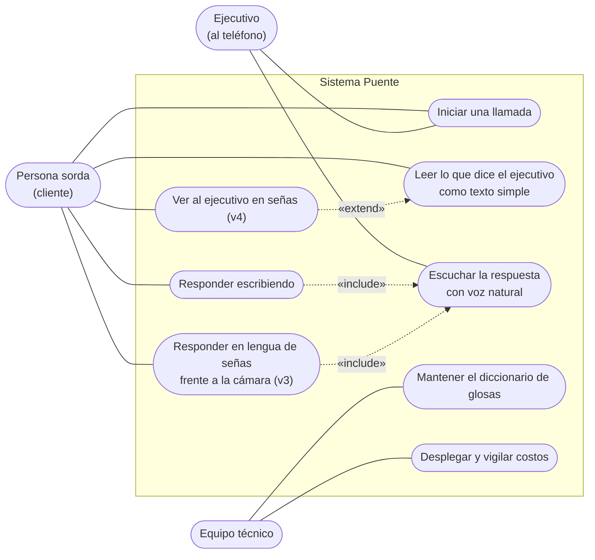

---

## 2. Componentes

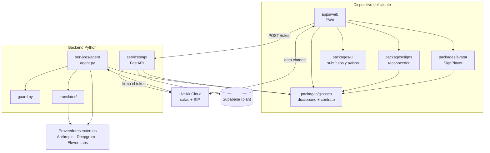

---

## 3. Clases: backend (Python)

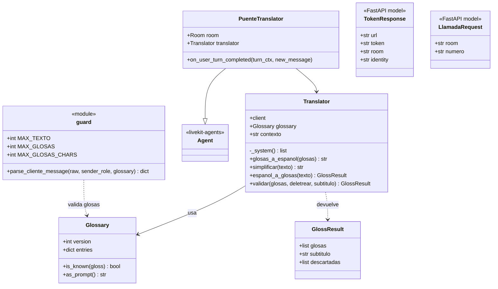

`guard.parse_cliente_message` devuelve el mensaje validado o `None`. `fingerspell()` y `FINGERSPELL_RE` viven en `translator/glossary.py`
y definen el formato `DACTILOLOGÍA:A-N-A` (máximo 20 letras).

---

## 4. Clases: cliente y contrato (TypeScript)

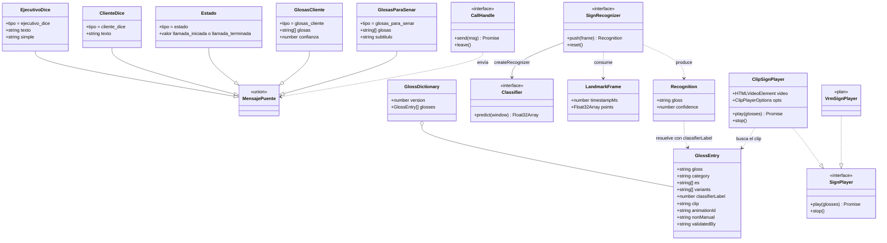

`parseMensaje` valida la forma de cada tipo, y `SOLO_AGENTE` (`ejecutivo_dice`, `estado`, `glosas_para_senar`) se acepta únicamente
si el emisor es el agente.

---

## 5. Secuencia: unirse a la llamada

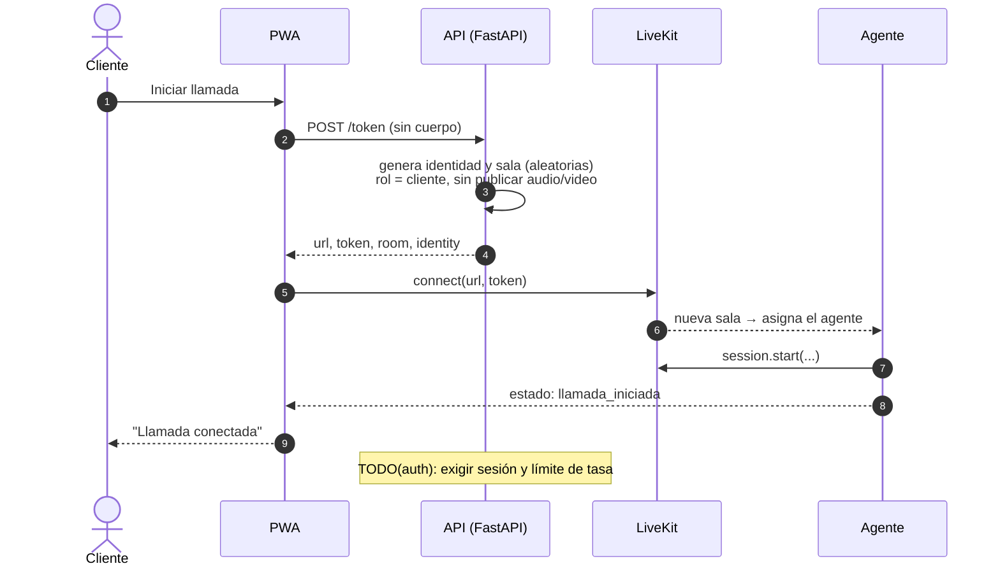

---

## 6. Secuencia: ejecutivo → cliente (voz a texto simple)

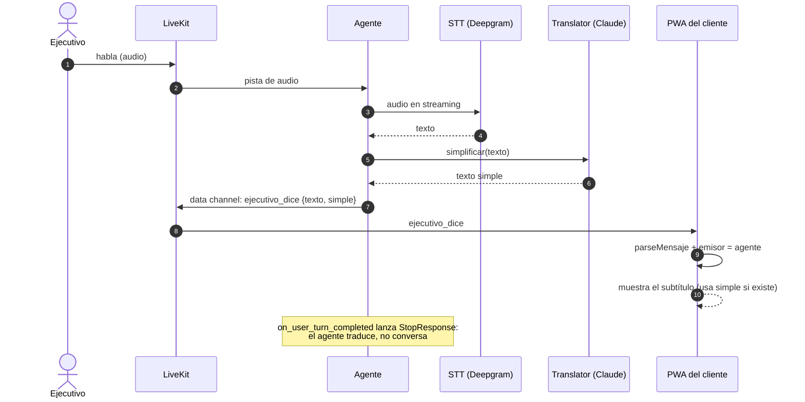

---

## 7. Secuencia: cliente escribe → ejecutivo (texto a voz)

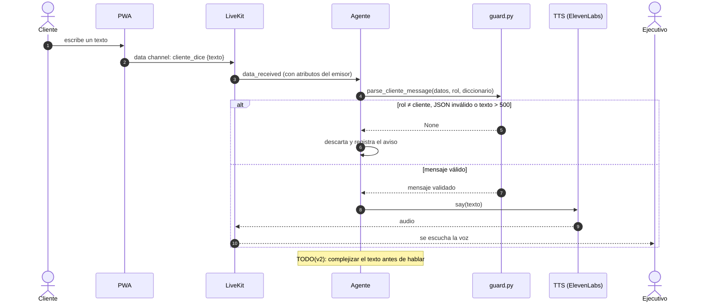

---

## 8. Secuencia: cliente firma → ejecutivo (señas a voz, v3)

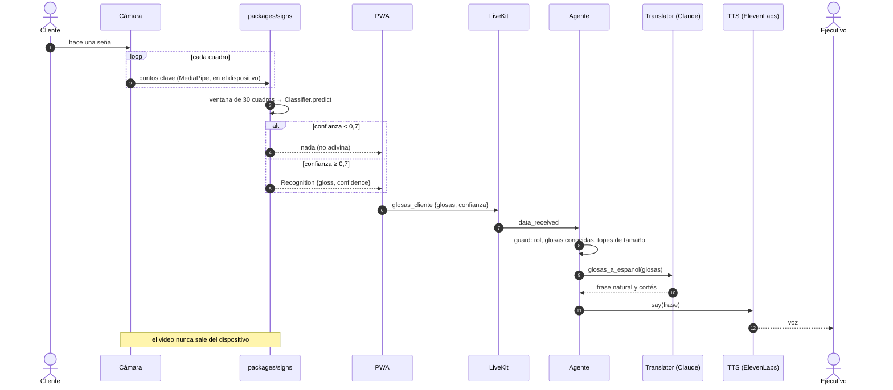

---

## 9. Secuencia: ejecutivo → cliente en señas (voz a señas, v4)

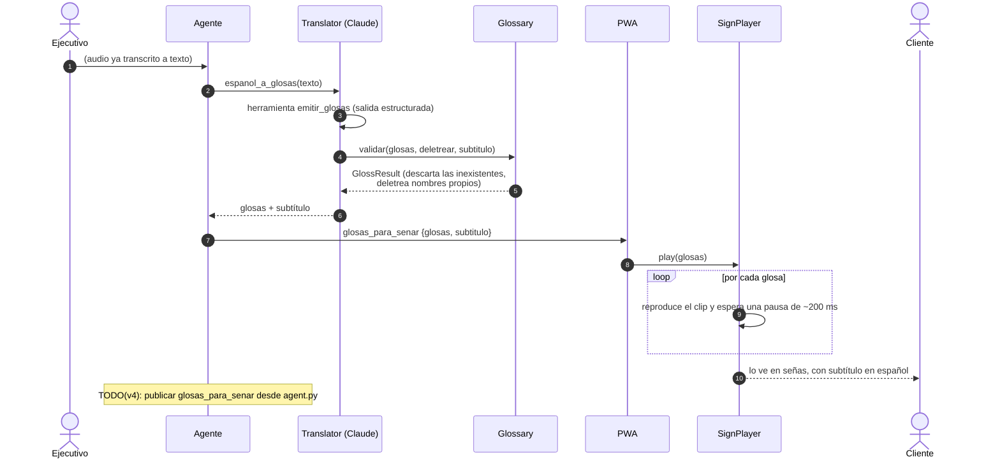

---

## 10. Secuencia: llamada saliente por teléfono **(plan)**

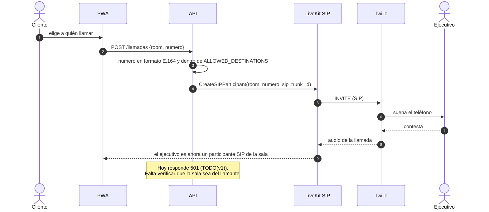

---

## 11. Estados: llamada

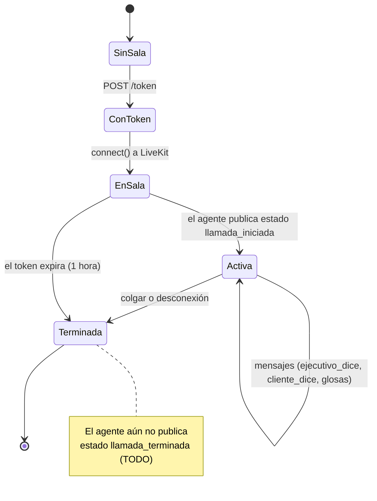

---

## 12. Estados: reconocimiento de una seña

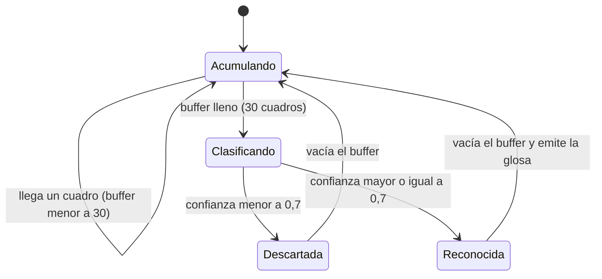

---

## 13. Actividad: validación de mensajes del cliente

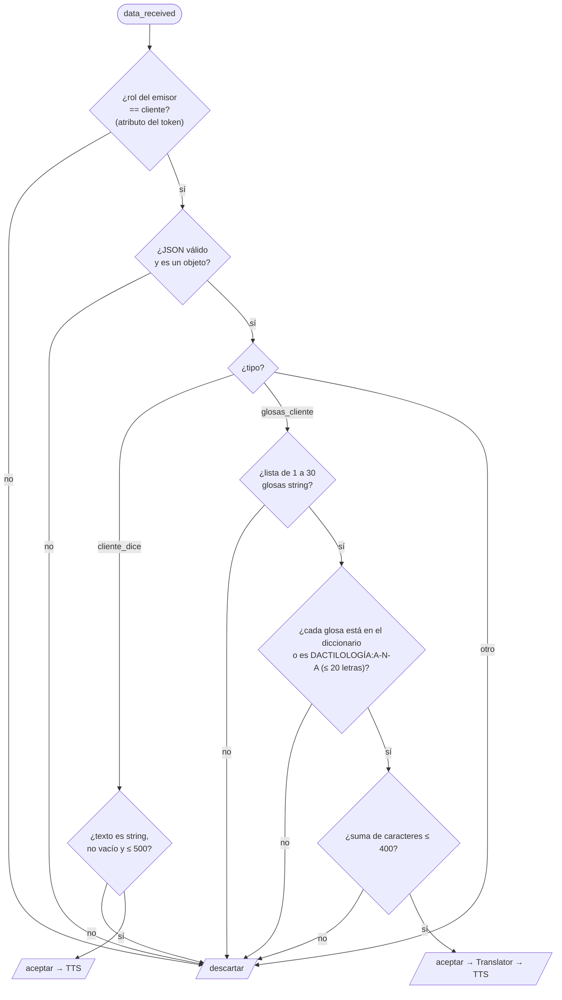

---

## 14. Despliegue **(plan)**

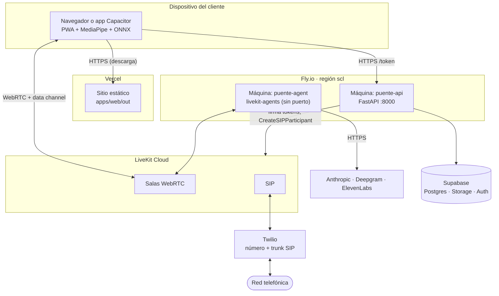
