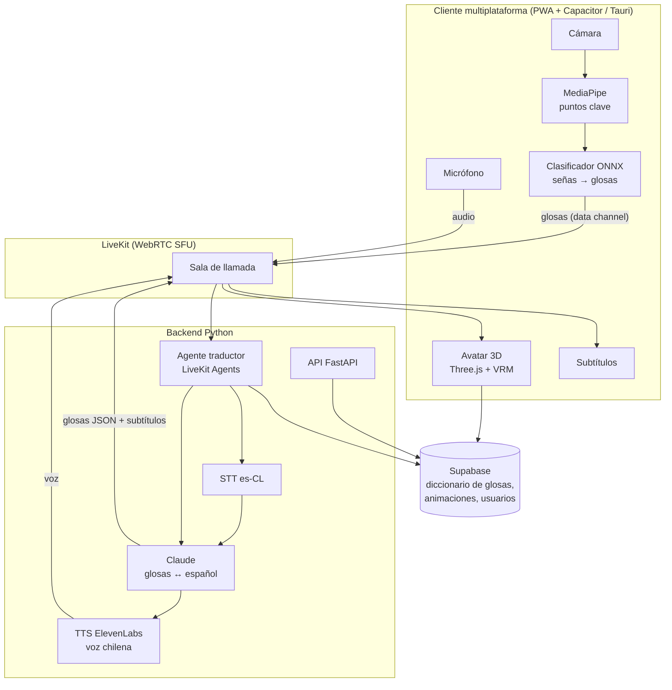

# Arquitectura y ADRs — Traductor LSCh ↔ Español chileno

Plataforma multiplataforma para que una persona que se comunica en **Lengua de Señas Chilena (LSCh)**
converse en tiempo real con una persona que habla **español chileno**:

- **Señas → español:** la cámara reconoce las señas y la app produce **voz y subtítulos**.
- **Español → señas:** la voz se transcribe, se **simplifica y traduce a glosas LSCh** y un **avatar 3D** ejecuta las señas.

## Resumen de requisitos

### Funcionales
| ID | Requisito |
|----|-----------|
| RF1 | Llamada de video y audio entre una persona sorda y una persona oyente |
| RF2 | Reconocimiento de señas LSCh desde la cámara (vocabulario acotado en el MVP) |
| RF3 | Traducción de glosas a español natural con voz (TTS es-CL) y subtítulos |
| RF4 | Transcripción del español hablado (STT es-CL) |
| RF5 | Simplificación y traducción de español a glosas LSCh |
| RF6 | Ejecución de las glosas con un avatar 3D, más subtítulos |
| RF7 | Disponible en web, Android, iOS y, opcionalmente, escritorio |
| RF8 | **(v1, producto central)** Llamadas a teléfonos convencionales (PSTN): el ejecutivo no instala nada |

### No funcionales
| Categoría | Objetivo MVP (hackathon) | Objetivo futuro |
|-----------|--------------------------|-----------------|
| Latencia extremo a extremo | < 3 s por turno en cada dirección | < 1,5 s |
| Concurrencia | ~10 llamadas simultáneas | 1.000+ |
| Disponibilidad | Nivel demo (sin SLA) | 99,9 % |
| Precisión del reconocimiento | ≥ 85 % top-1 sobre el vocabulario del MVP | Vocabulario abierto |
| Privacidad | Sin grabar video; los puntos clave se procesan en el cliente | Cumplimiento de la normativa chilena de datos personales |
| Accesibilidad | WCAG 2.2 AA en la UI, avisos visuales en vez de sonoros | AAA en los flujos críticos |
| Costo | Planes gratuitos o créditos de hackathon | Costo por minuto de llamada medido |

## Diagrama de alto nivel

## Índice de ADRs

| # | Decisión | Estado |
|---|----------|--------|
| [0001](0001-glosas-lsch-como-representacion-intermedia.md) | Glosas LSCh como representación intermedia | Propuesto |
| [0002](0002-reconocimiento-de-senas-por-puntos-clave.md) | Reconocimiento de señas por puntos clave (MediaPipe) y vocabulario acotado | Propuesto |
| [0003](0003-generacion-de-senas-con-avatar-3d.md) | Generación de señas con avatar 3D, no video generativo | Propuesto |
| [0004](0004-agente-traductor-llm-con-salida-estructurada.md) | Agente traductor LLM (Claude) con salida estructurada y vocabulario restringido | Propuesto |
| [0005](0005-tiempo-real-con-livekit.md) | Llamadas en tiempo real con LiveKit y el traductor como participante | Propuesto |
| [0006](0006-stt-y-tts-espanol-chileno.md) | Proveedores de STT y TTS en español chileno (TTS: ElevenLabs) | Propuesto |
| [0007](0007-cliente-multiplataforma-pwa-capacitor.md) | Cliente multiplataforma: PWA + Capacitor + Tauri | Propuesto |
| [0008](0008-monorepo-ts-y-backend-python.md) | Monorepo TypeScript (pnpm + Turborepo) y backend Python | Propuesto |
| [0009](0009-supabase-para-datos-y-archivos.md) | Supabase para datos y archivos | Propuesto |
| [0010](0010-privacidad-procesamiento-en-el-cliente.md) | Privacidad: puntos clave en el cliente y sin almacenar video | Propuesto |
| [0011](0011-despliegue-vercel-y-contenedores.md) | Despliegue: Vercel (front) y contenedor Docker (agente) | Propuesto |

## Principales riesgos y mitigaciones

| Riesgo | Impacto | Mitigación |
|--------|---------|------------|
| Pocos datos públicos de LSCh | Reconocimiento pobre | Vocabulario acotado y dataset propio (ADR-0002) |
| Glosas mal traducidas por el LLM | Mensaje equivocado para la persona sorda | Vocabulario cerrado, validación del JSON y validación con personas sordas (ADR-0004) |
| Latencia acumulada STT → LLM → TTS | Conversación poco natural | Streaming en cada etapa, modelo rápido, subtítulos antes que la voz (ADR-0005/0006) |
| Rendimiento en teléfonos modestos | Pérdida de cuadros y reconocimiento lento | Delegado GPU, 480p, respaldo de puntos clave en el servidor (ADR-0007) |
| Falta de validación con la comunidad sorda | Producto culturalmente incorrecto | Involucrar a personas sordas o intérpretes LSCh desde el día 1 |

## Proceso

- Nuevo ADR: copiar la estructura de uno existente, usar el siguiente número y añadirlo al índice.
- Estados: `Propuesto` → `Aceptado` (cuando el equipo lo valida) → `Obsoleto` / `Reemplazado por ADR-XXXX`.
- Los ADRs aceptados no se editan: se reemplazan con uno nuevo.
